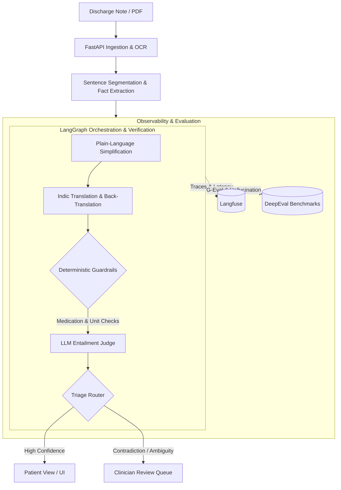

# 🏥 DCare / Clinical Discharge Explainer

[](https://nextjs.org/)
[](https://fastapi.tiangolo.com/)
[](https://langchain-ai.github.io/langgraph/)
[](https://langfuse.com/)
[](https://confident-ai.com/)
[](https://opensource.org/licenses/MIT)

> **Production-grade AI pipeline that transforms complex, clinical discharge summaries into verified, plain-language patient instructions across 10 Indic languages — backed by deterministic guardrails, LangGraph orchestration, Langfuse tracing, and DeepEval automated rigor.**

---

## 📌 Executive Summary

Clinical discharge documentation is dense, jargon-laden, and prone to patient misinterpretation, often leading to avoidable readmissions and dangerous medication non-adherence. 

**DCare** solves this using an auditable, multi-stage agentic workflow:
1. **Fact Extraction**: Breaks medical discharge records into isolated clinical facts linked to exact source sentences.
2. **Plain-Language Translation & Simplification**: Translates complex instructions into accessible language in English and **10 Indian languages** (Hindi, Bengali, Gujarati, Kannada, Malayalam, Marathi, Odia, Punjabi, Tamil, Telugu) with strict entity preservation.
3. **Automated Multi-Tier Verification**: Runs 18 deterministic checks (dosages, polarity, contradiction traps) + LLM-as-a-judge verification.
4. **Human-in-the-Loop (HITL) Triage**: Flagged or ambiguous claims are escalated directly to a clinician review queue rather than silently misleading patients.
5. **Full Observability**: End-to-end tracing and evaluation via **Langfuse** and **DeepEval**.

---

## 🏗️ System Architecture



---

## 🚀 Deployment & Tech Stack

| Layer | Technology | Hosting / Platform |
|---|---|---|
| **Frontend** | Next.js 14 (App Router), Tailwind CSS, TypeScript | **Vercel** |
| **Backend** | FastAPI, Python 3.11, Docker, Pydantic v2 | **Render** |
| **Orchestration** | LangGraph | Containerized Worker |
| **Database** | PostgreSQL + SQLAlchemy | **Supabase** |
| **LLM Inference** | Ollama (Local) / Groq LLaMA 3.3-70B / Sarvam-1 | Hybrid / Cloud |
| **Observability** | Langfuse (OpenTelemetry Traces & Spans) | Cloud / Self-hosted |
| **CI / Evals** | DeepEval (G-Eval, Hallucination Metric), Pytest | GitHub Actions |

---

## 📈 Evaluation & Benchmarks

We emphasize **rigorous, multi-faceted evaluation** to measure factual correctness, clinical safety, and linguistic fidelity.

### 1. Offline DeepEval Evaluation (340 Clinical Claims)
Run against our benchmark dataset using LLM-as-a-judge scoring (`qwen3:1.7b`):

| Metric | Result | Target Benchmark | Status |
|---|---|---|---|
| **Hallucination Score** | **0.959 / 1.00** | > 0.90 | ✅ High Fidelity (326/340 Perfect 1.0) |
| **Clarity G-Eval Score** | **0.311 / 1.00** | Strict Criteria | ⚠️ Heavy penalty on non-medication claims |
| **Source Link Accuracy** | **100% (340/340)** | 100% | ✅ Zero citation drift |
| **Contradiction Catch Rate**| **100% (14/14)** | 100% | ✅ Traps correctly escalated to clinician |

### 2. Deterministic Guardrail Check Matrix (18 Internal Rules)

* **Source ID & Fact Extraction:** 100% pass (340/340)
* **Numeric, Frequency & Date Consistency:** 100% pass (339/340)
* **Clause Preservation & Synonym Drift:** 100% pass (340/340)
* **Medication Contradiction Traps:** 100% flagged & isolated
* **Instruction Polarity & Negation:** 97% pass

### 3. Indic Multilingual Translation (Sarvam-1 Benchmark)
Evaluated across 80 outputs in 10 languages (Hindi, Bengali, Gujarati, Kannada, Malayalam, Marathi, Odia, Punjabi, Tamil, Telugu):
- **48.8% strict verbatim token match** for medical entities (dosages, chemical names, timing) across diverse writing scripts.
- Integrated back-translation review loops to prevent critical semantic drift.

---

## 🔍 Observability with Langfuse

Every generation, agent step, and verifier decision is traced using **Langfuse**:
- **Traces & Spans:** Detailed execution tree mapping token counts, prompt templates, and execution latency.
- **Cost & Latency Tracking:** Granular analytics per translation and verification step.
- **Failure Analysis:** Direct linking of user feedback to trace IDs for rapid edge-case debugging.

---

## ⚡ Quickstart

### Prerequisites
- Python 3.11+
- Node.js 18+
- Docker & Docker Compose (optional)
- Local Ollama or remote Groq / OpenAI-compatible API key

### 1. Clone & Setup Environment
```bash
git clone https://github.com/<your-username>/discharge-explainer.git
cd discharge-explainer
cp .env.example .env
```

### 2. Backend Setup
```bash
cd backend
python -m venv .venv
source .venv/bin/activate
pip install -r requirements.txt
uvicorn app.main:app --reload --host 0.0.0.0 --port 8000
```

### 3. Frontend Setup
```bash
cd frontend
cp .env.example .env.local
npm install
npm run dev
```
Open [http://localhost:3000](http://localhost:3000) to view the application.

### 4. Running Offline Evaluations
Run the full DeepEval & deterministic benchmark suite:
```bash
python eval/run_offline_evals.py
```
Results are saved to `eval/results/offline_eval_results.json`.

